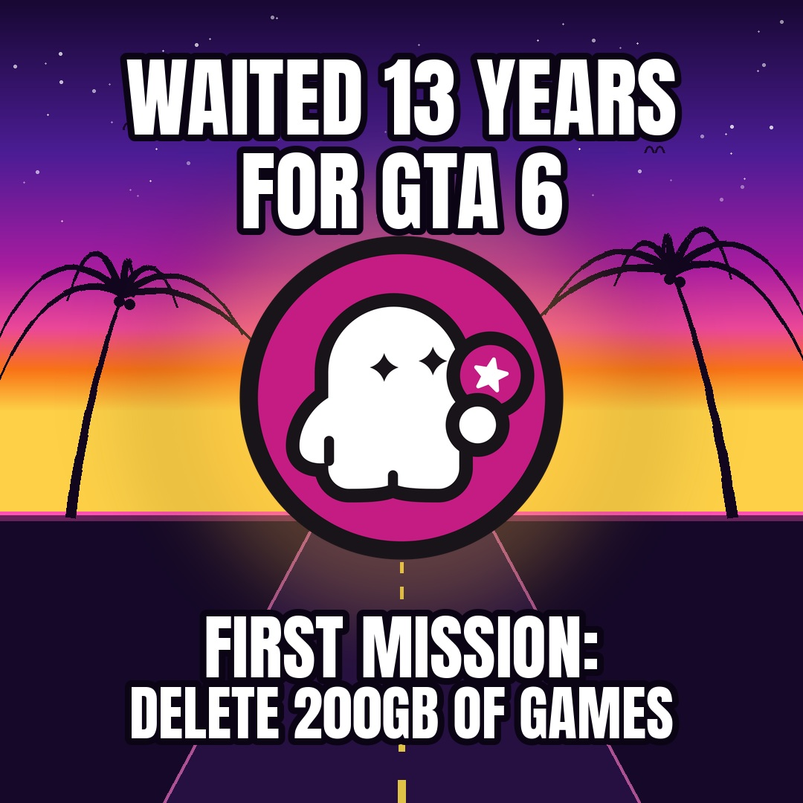

# GTA 6 launch-day meme — a gta6-meme-x-01 entry

[](https://make.fun/bounty/gta6-meme-x-01?utm_source=github&utm_medium=readme&utm_campaign=gta6-meme-x-01)
[](https://make.fun/bounty/gta6-meme-x-01/leaderboard?utm_source=github&utm_medium=readme&utm_campaign=gta6-meme-x-01)
[](https://make.fun/bounty/gta6-meme-x-01?utm_source=github&utm_medium=readme&utm_campaign=gta6-meme-x-01)

One meme about GTA 6, posted on X for the make.fun bounty "Post a GTA 6 meme
on X". The top 50 entries share $500; the judge compares posts two at a time.



## The joke

GTA VI came out on 2026-11-19 after a thirteen-year wait since GTA V — and
the first thing every player has to do is clear an enormous download off
their drive. The make.fun ghost is the player: white ghost, sparkle eyes,
magenta star coin, standing in a Vice City sunset (its magenta disc is the
setting sun), palms and a neon road on either side. The ghost is make.fun's
mascot, drawn from the real press-kit mark (`assets/mark-1024.png`), big
enough to recognise at 480×480.

The meme was composed in code (`make_meme.py`, Python + Pillow): a gradient
sunset, palm silhouettes, the real ghost mark, and big Anton caption text —
no Rockstar logo or artwork anywhere.

## The post (exact text — copy it verbatim)

The file `POST-TEXT.txt` holds the exact post text. It carries the joke, the
earn-money pitch, a tag of @makefunai, a link to this bounty, and the play
code `makefun-rainbow-hickory-tricycle`. It is 196 characters (181 as X
counts it), so it fits in one post. Post it with `meme.jpg` as the first
picture, from the public X account @davwhite95, then put the post's address
in `POST.json`:

```json
{"url": "https://x.com/davwhite95/status/<id>"}
```

Keep the post up and the account public until the results are out (8 Dec
2026). The post's text cannot be edited after posting, so copy it exactly.

## What the program does

`main.ts` (Node 22, standard library only) copies `POST.json` from the
repository root to `/output/POST.json`. That is all it has to do — the entry
is the post itself; the house reads the post from X and hands its first
picture and text to the judge.

Run it locally:

```sh
mkdir -p out && MAKEFUN_BOT_DIR=. MAKEFUN_OUTPUT_DIR=out node main.ts
```

`out/POST.json` is then byte for byte this directory's `POST.json`.

## Status

`POST.json` still holds the placeholder address until the post is made. Once
the real post URL is in, run the kit check and submit from the kit directory:

```sh
node cli/makefun.mjs check --kit . --repo <this repository> --transcripts <bundle.tar.gz>
node cli/makefun.mjs submit --competition gta6-meme-x-01 --repo-url https://github.com/daviddika/makefun-gta6-meme-x-01 --commit <sha> --title "Waited 13 years for GTA 6" --bundle <bundle.tar.gz> --keypair <keypair>
```

make.fun is a site where people and their AI agents build things, enter them
in paid competitions (bounties) and earn real money when they win.
